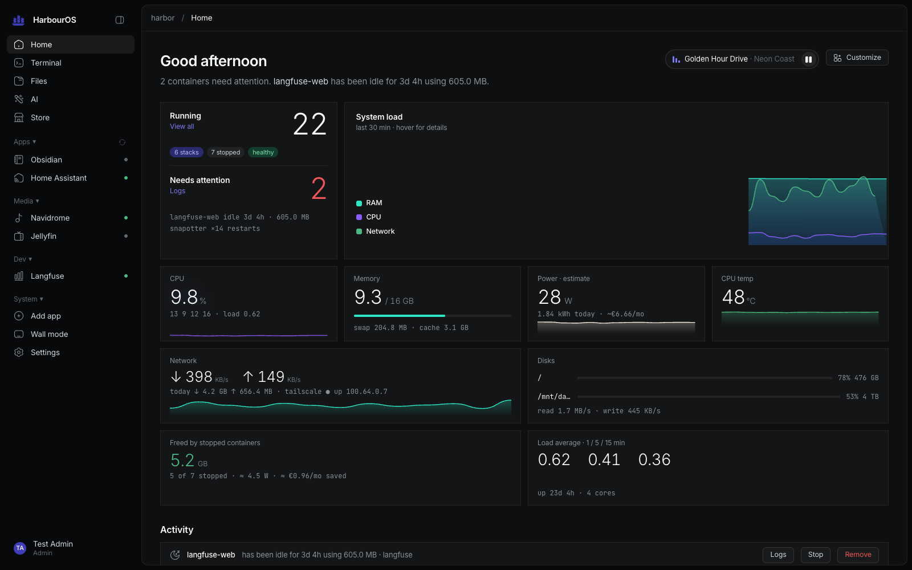
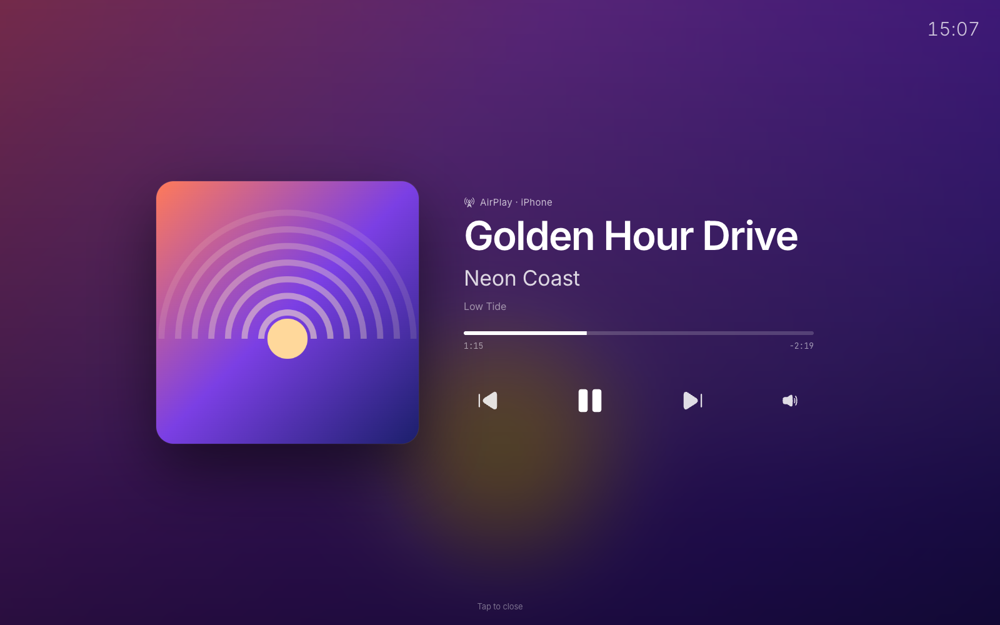
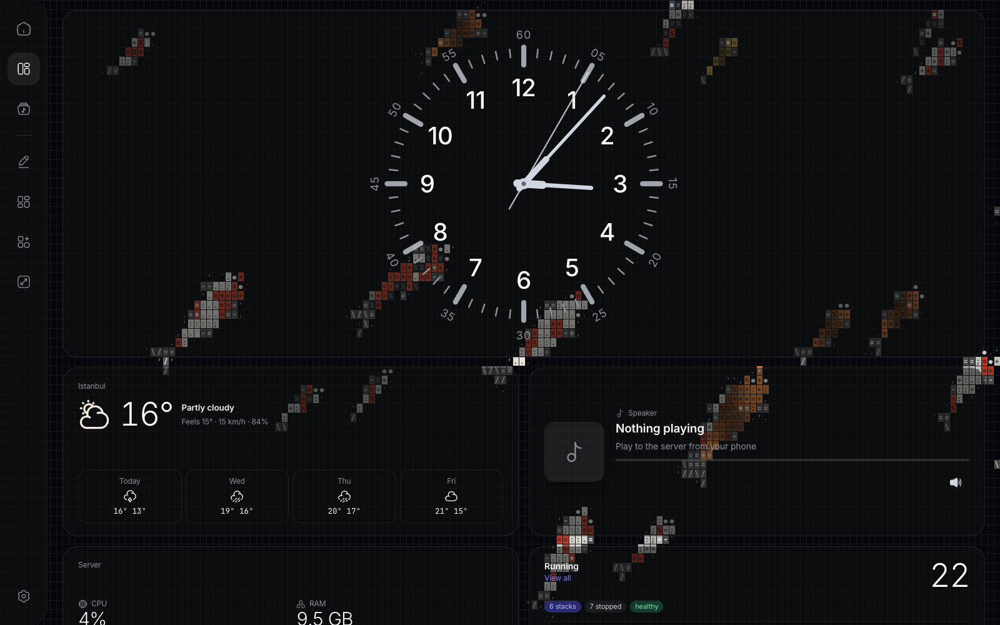

<p align="center">
  <picture>
    <source media="(prefers-color-scheme: dark)" srcset="docs/brand/wordmark-dark.png">
    
  </picture>
</p>

<p align="center">
  <b>A self-hosted desktop for your home server, in one browser tab.</b><br>
  Open every service, run containers, use a terminal and Claude, and turn a spare tablet into a wall display.
</p>

<p align="center">
  
  
  
  
</p>

<p align="center">
  
</p>

## Quick start

You need a Linux server with Docker and Docker Compose. [Tailscale](https://tailscale.com) is recommended, so only your own devices can reach it.

```bash
git clone https://github.com/doppIer/HarbourOS.git
cd HarbourOS
cp .env.example .env      # put your server's Tailscale IP in TAILSCALE_IP
docker compose up -d --build
```

Open `http://<TAILSCALE_IP>:7080` and create the first account: that's the admin.

Optional, each one command on the server (in the HarbourOS folder):

| What | Command |
|---|---|
| Browser terminal and Files over SSH | `sudo bash host/setup-terminal.sh` |
| HTTPS on your tailnet (needed for some browser features) | `sudo bash host/setup-https.sh` |
| Now Playing for AirPlay / Spotify Connect on the server's speaker | `sudo bash host/setup-nowplaying.sh` |
| Real CPU power readings | `sudo bash host/rapl-permissions.sh` |

Update later with:

```bash
git pull && docker compose up -d --build
```

> [!IMPORTANT]
> Don't expose port 7080 to the internet. Compose binds it to your Tailscale IP only.

## What's inside

**Desktop**
- Every self-hosted app in one sidebar, opened inside HarbourOS (or in a tab when an app refuses frames). Stopped apps start when you open them and can stop again when idle.
- Live dashboard with editable widgets: CPU, memory, power and cost, network, disks, containers.
- Containers: start, stop, restart, remove, logs.
- App store with the CasaOS catalog, with a clear warning before anything gets deep access to the host.
- Files, a browser terminal (tmux), and Claude / local models that can look at your server and propose actions you approve.
- Accounts for the household: admins and members, sign-up with approval.

**Wall mode** (`/wall`, made for a tablet that stays on)
- Ready-made layouts (Home, Agenda, Commute, Bedside, Server) or your own; each person and each tablet has their own wall.
- Clock (big digits, watch face or flip cards), weather, calendar (iCloud / Google share link), bus and tram departures from any GTFS timetable, server stats.
- **Now Playing:** play to the server's speaker from your phone (AirPlay or Spotify Connect) and the wall shows the song full screen, with controls and volume.
- **DJ mode** for your Navidrome library.
- **Night mode:** from midnight to 6 a.m. everything turns red and the wall shows only the time and weather.
- ASCII animal backgrounds, light and dark, screen dimming, burn-in protection, pairing tablets with a code.

<table>
  <tr>
    <td width="50%"><br><sub><b>Wall mode.</b> Big clock, weather, music and server at a glance.</sub></td>
    <td width="50%"><br><sub><b>Now Playing.</b> Opens by itself when your phone plays to the server.</sub></td>
  </tr>
  <tr>
    <td><br><sub><b>Night mode.</b> Red, dark, only time and weather.</sub></td>
    <td><br><sub><b>Watch face.</b> One of three clock styles.</sub></td>
  </tr>
  <tr>
    <td><br><sub><b>Night watch face.</b></sub></td>
    <td><br><sub><b>DJ mode.</b> Your Navidrome library on the tablet.</sub></td>
  </tr>
</table>

<p align="center"><sub>Screenshots use the built-in demo mode (<code>HARBOR_DEMO=1</code>); the music is a made-up example.</sub></p>

## Security in short

Every API and WebSocket needs a session, members can't reach admin actions, and the app runs as an unprivileged user. The terminal is a real shell on your host and its user can run Docker, so **admin means root on the server**: give it only to people you'd trust with that. Details in the [guide](docs/GUIDE.md#security-notes).

## More

- [Full guide](docs/GUIDE.md): setup details, apps, store, widgets, backgrounds, HTTPS, wall, development.
- Try it without a server: `HARBOR_DEMO=1` simulates data (the screenshots use it).

## Credits

ASCII animal backgrounds: [ascii-animals](https://github.com/DesignerStephen1/ascii-animals) by DesignerStephen1 (MIT).
