<p align="center">
  <picture>
    <source media="(prefers-color-scheme: dark)" srcset="docs/brand/wordmark-dark.png">
    
  </picture>
</p>

<p align="center">
  <b>A self-hosted desktop for your home server, in one browser tab.</b><br>
  Open every service, start and stop containers, watch the machine live, and use a terminal and Claude without leaving the page.
</p>

<p align="center">
  
  
  
  
  
  
</p>

<p align="center">
  
</p>

<p align="center"><sub>Screenshots use the built-in demo mode (<code>HARBOR_DEMO=1</code>), so the numbers are simulated.</sub></p>

---

## What it does

|  |  |
|---|---|
| **Sidebar of your services** | Linear-style, collapsible, with live status dots: grey stopped, amber starting, green running, red crash-looping. Drag to reorder, right-click or long-press for Restart, Stop, Logs, Edit. |
| **Start on demand** | Opening a stopped app starts its container, or its whole compose stack in dependency order, and shows a boot screen until the health check passes. |
| **Idle auto-stop** | Apps nobody has used for N minutes are stopped to save power. "Always on" apps (Home Assistant, bots) are never touched. Works alongside Sablier and Traefik. |
| **App store** | 183 apps from the CasaOS catalog, sorted by Docker Hub downloads. Pick ports and folders, install with one click, and the app lands in the sidebar. |
| **Live dashboard** | CPU per core, temperature, RAM, swap, disks, network, Tailscale, estimated watts and monthly cost, and how much stopped containers are saving. |
| **Widgets you edit as files** | Every tile is a small JS file in `data/widgets/`. Save it and the tile reloads in every open browser, with no build or restart. |
| **Terminal** | xterm.js tabs backed by tmux on the host, so sessions survive closing the browser. iPhone gets an extra key row. |
| **Claude** | Chat that can read live stats, containers and logs. Anything that changes the server appears as a card you approve first. A second tab runs Claude Code in tmux. |
| **Accounts** | Admin and member roles, sign-up with admin approval, scrypt-hashed passwords. Members see the dashboard and open apps; only admins get the terminal, Claude and controls. |
| **Light on the box it watches** | One Node process (~40 MB idle), one WebSocket per tab, stats collected once and fanned out, slowing to every 30 s when nobody's looking. ~29 KB gzipped main bundle; terminal and Claude load on demand. |

## Screenshots

<table>
  <tr>
    <td width="50%">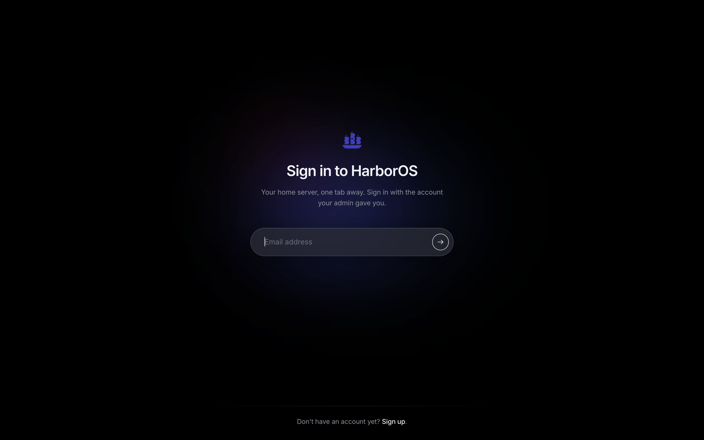<br><sub><b>Sign in.</b> One field at a time; the background is a replaceable slot.</sub></td>
    <td width="50%">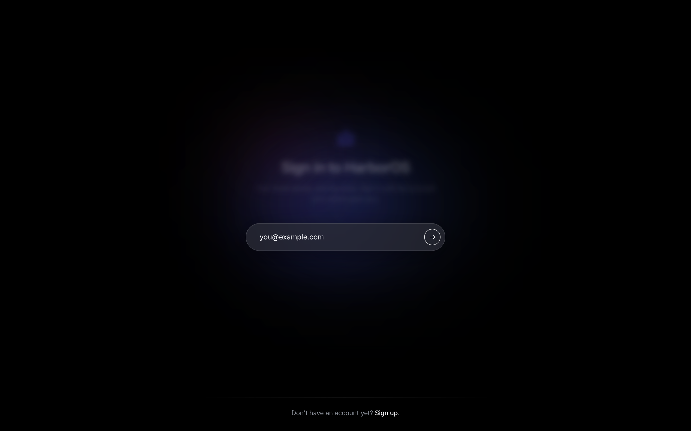<br><sub><b>Focus.</b> The heading softens while you type.</sub></td>
  </tr>
  <tr>
    <td>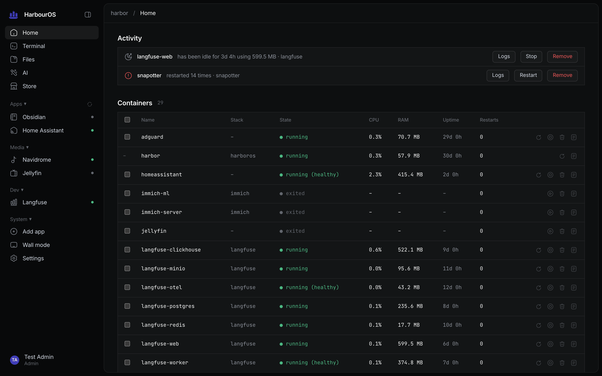<br><sub><b>Activity and containers.</b> Idle stacks and crash loops are called out with one-click actions.</sub></td>
    <td>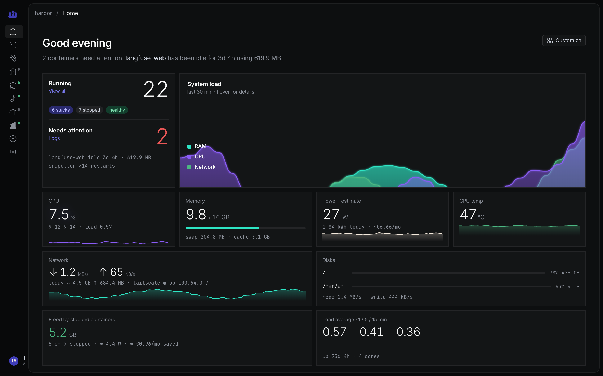<br><sub><b>Collapsed sidebar.</b> An icon rail that keeps the status dots.</sub></td>
  </tr>
  <tr>
    <td>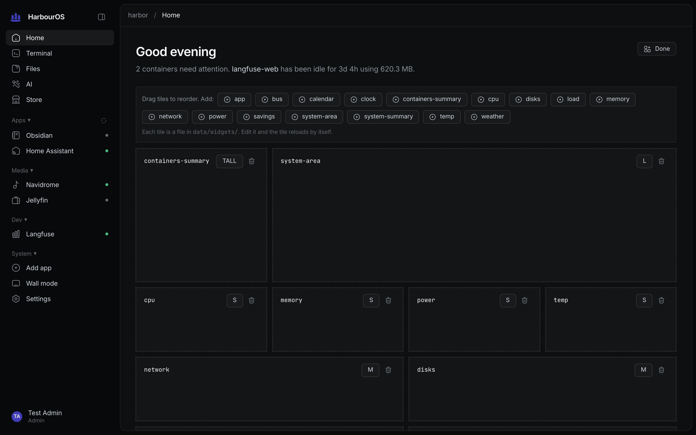<br><sub><b>Customize.</b> Reorder, resize, add and remove tiles.</sub></td>
    <td>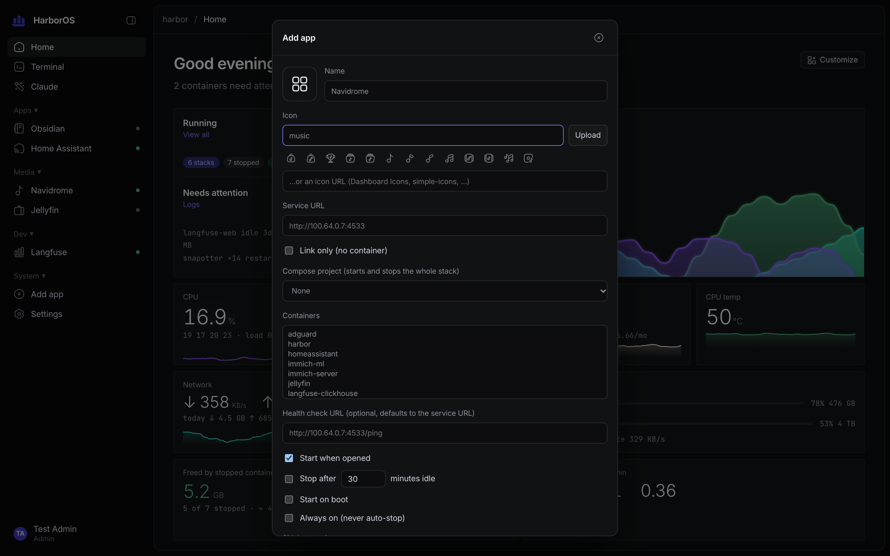<br><sub><b>Add app.</b> Icon search, containers or a compose stack, health check, auto start and stop.</sub></td>
  </tr>
  <tr>
    <td>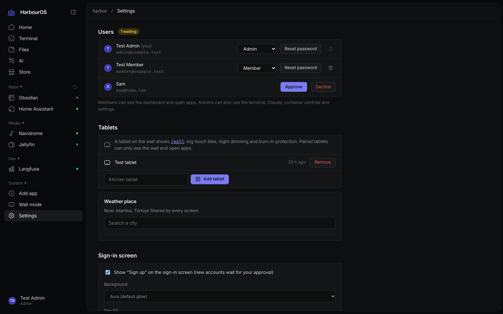<br><sub><b>Users and settings.</b> Approve sign-ups, change roles, pick backgrounds.</sub></td>
    <td>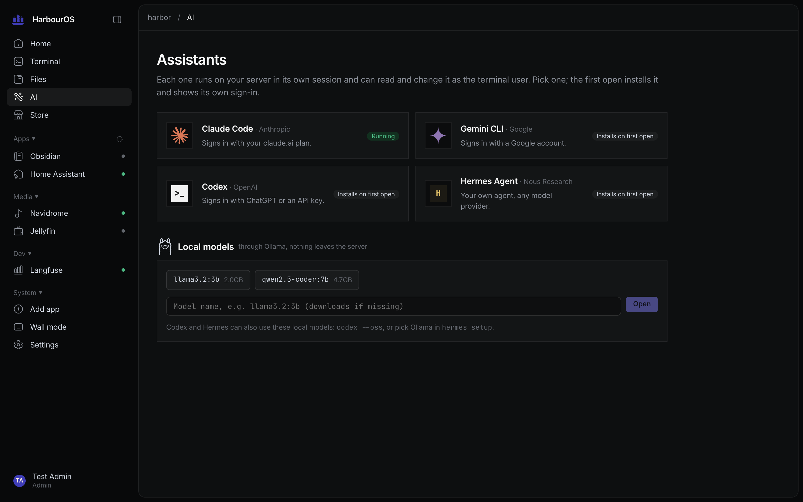<br><sub><b>Claude.</b> Asks about your server; actions need your tap.</sub></td>
  </tr>
  <tr>
    <td>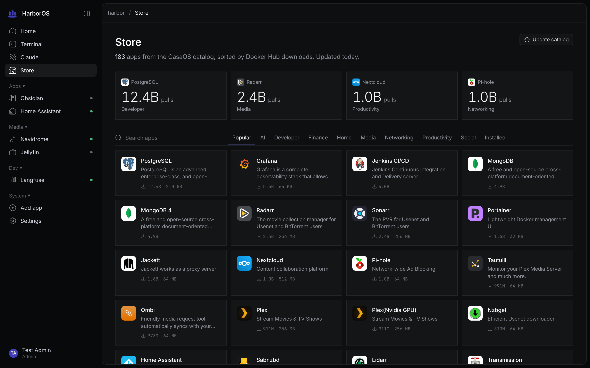<br><sub><b>Store.</b> Most-downloaded first, search and categories.</sub></td>
    <td>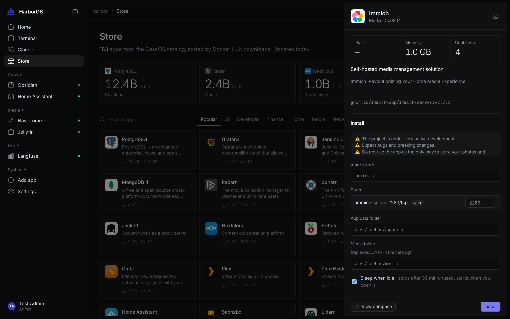<br><sub><b>Install.</b> Ports, folders and idle sleep; view the compose file first.</sub></td>
  </tr>
</table>

<p align="center">
  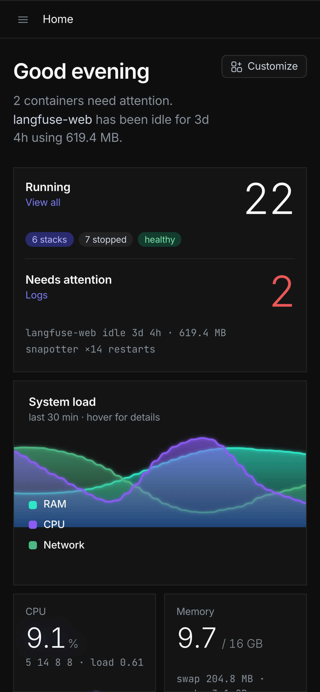
  &nbsp;&nbsp;
  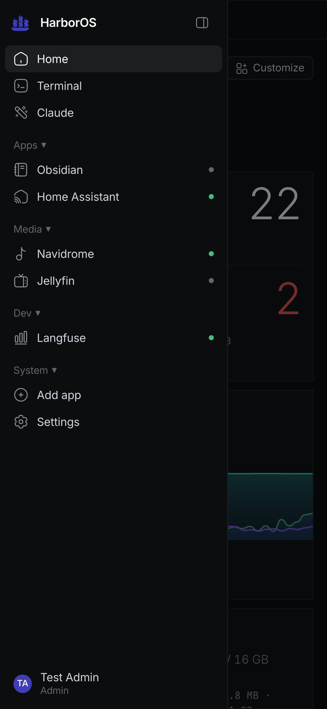
</p>
<p align="center"><sub>On iPhone: installable as a PWA, safe-area aware, with a slide-out menu.</sub></p>

## How it fits together

```
browser ──(Tailscale)──► harbor (Node/Fastify) ──► docker-socket-proxy ──► dockerd
                              │  /host/proc, /host/sys (read-only)
                              │  ssh → host tmux (terminal, claude)
                              └  SQLite in ./data
```

- **Backend:** Node 22 + TypeScript + Fastify. One collection loop reads `/proc`, `/sys` and Intel RAPL, and pushes to every open tab over a single multiplexed WebSocket.
- **Store installs:** `docker compose` runs on the host over SSH (see [App store](#app-store)), not through the proxy.
- **Docker:** only through [`tecnativa/docker-socket-proxy`](https://github.com/Tecnativa/docker-socket-proxy) with list, inspect, logs, events, start, stop and restart. The raw socket is never mounted into the web container.
- **Frontend:** Preact + signals + Vite. Charts are canvas on one shared `requestAnimationFrame` loop that pauses while the tab is hidden.
- **Storage:** SQLite for apps, settings, accounts, energy history and Claude conversations.

## Setup

On the server, in this folder:

```bash
cp .env.example .env              # set TAILSCALE_IP, SESSION_SECRET, ANTHROPIC_API_KEY
mkdir -p data && cp config/harbor.example.json data/harbor.json   # edit URLs/containers to match yours
sudo bash host/setup-terminal.sh  # tmux + SSH key for the browser terminal
sudo bash host/rapl-permissions.sh   # optional, for the power estimate
docker compose up -d --build
```

Open `http://<TAILSCALE_IP>:7080`. The first visit shows **Set up HarborOS**: the account you create there is the admin.

`data/harbor.json` is read only on first boot. After that, apps live in SQLite and you manage them from the UI.

> [!IMPORTANT]
> **Never expose port 7080 to the internet.** Compose binds it to your Tailscale IP only.

To serve it over HTTPS with Tailscale identities:

```bash
tailscale serve --bg 7080
```

Then set `TRUST_TAILSCALE_HEADERS=1` and `TAILSCALE_ALLOWED_USERS=you@example.com` in `.env`. Each allowed login must match the email of an active HarborOS account. When header auth is on, keep 7080 bound to `127.0.0.1` so only `tailscale serve` can reach it.

## Accounts

- **Admin:** can do everything.
- **Member:** sees the dashboard and opens apps. Can't use the terminal, Claude, container controls or settings; the server enforces this, not just the UI.
- **Sign-up:** the sign-in screen has a Sign up link while **Settings → Sign-in screen → Show "Sign up"** is on (the default). New accounts wait as "pending" until an admin approves them under **Settings → Users**, where you can also change roles or delete accounts. HarborOS always keeps at least one admin.
- **Passwords:** stored as scrypt hashes. Changing your password signs out your other devices.

## Adding an app

Click **Add app** in the sidebar. You can set:

- name and icon (search Solar icons, upload a file, or paste a URL from Dashboard Icons or simple-icons)
- service URL
- the containers it uses, or a whole compose project
- a health check URL
- whether it starts when opened, stops after N idle minutes, starts on boot, or is always on

Link-only apps (no container) work too. Everything is saved on the server.

Some apps refuse to load inside an iframe because of `X-Frame-Options` or a CSP `frame-ancestors` header. For those, remove the header in your reverse proxy, or use **Open in new tab**.

## App store

**Store** in the sidebar (admins only) lists the [CasaOS AppStore](https://github.com/IceWhaleTech/CasaOS-AppStore) catalog (Apache-2.0), with pull counts from Docker Hub. The catalog is fetched on first visit (about 20 seconds: only each app's compose file and icon, not the 250 MB repo) and cached in `data/store/`. **Update catalog** fetches it again.

When you install an app, HarborOS rewrites its compose file for your server:

- `/DATA/AppData` becomes your app data folder and the rest of `/DATA` becomes your media folder (defaults `/srv/harbor/appdata` and `/srv/harbor/media`, remembered for next time)
- ports you pick replace the catalog's; ports other containers already use are refused
- devices and host folders your machine doesn't have (many entries target Raspberry Pi) are removed, and the panel lists what was removed
- privileged containers, the host network, the Docker socket and mounts of `/`, `/etc` and similar need an extra confirmation
- **View compose** shows the exact file before you install

It then runs `docker compose up -d` **on the host** over the terminal's SSH connection, so the user from `host/setup-terminal.sh` must be in the `docker` group. Stacks live in `~/harbor-stacks/<name>/` on the host as ordinary compose projects. The docker-socket-proxy keeps its start/stop-only permissions; it never gets image pull or create rights. Progress streams into the panel, and the finished app appears in the sidebar with start on demand, plus a 30-minute idle stop if you left **Sleep when idle** on.

**Uninstall** runs `docker compose down` and removes the stack folder. Its data is only deleted if you tick the box.

> [!NOTE]
> Catalog entries are maintained by the CasaOS community. Read the compose file for anything you don't recognise; image tags in the catalog can lag behind upstream.

## Dashboard widgets

Every tile on Home is a plain ES module in `data/widgets/`. Edit a file and save, and that tile reloads in every open browser. If you break a widget, only its tile shows the error. Delete the file to get the default back. **Customize** on Home writes the layout to `data/widgets/layout.json`.

```js
// data/widgets/my-widget.js
export default {
  title: "Uptime",
  sizes: ["s", "m"],
  mount(el, { ui, size, actions }) {
    const n = ui.bigNumber(el, { label: "Uptime", unit: " days" });
    const spark = ui.sparkline(el, { color: ui.theme.teal });
    return {
      update({ stats, containers, apps, history }) {
        n.set((stats.uptime / 86400).toFixed(1));
        spark.set(history.cpu);
      },
      destroy() {},
    };
  },
};
```

`ctx.ui` gives you:

- `bigNumber`, `sparkline`, `area` (layered area chart with crosshair and trend card), `bar`, `legend`
- `h` (a tiny element builder)
- `fmt` (`bytes`, `rate`, `pct`, `dur`, `ago`) and `theme` colors

`update` runs only when live data arrives. `actions.container(name, "start" | "stop" | "restart")` and `actions.open(view)` are available too. The data shapes are in `server/src/protocol.ts`.

## Backgrounds

The desktop and the sign-in screen each have a background slot (**Settings → Appearance** and **Settings → Sign-in screen**). Choose None, the built-in "aura" glow, an image or video URL, or your own module in `data/backgrounds/<name>/index.js`, with no rebuild:

```js
export function mount(el, { reducedMotion }) {
  // draw into el (canvas, DOM, …) using requestAnimationFrame
  return { pause() {}, resume() {}, destroy() {} };
}
```

HarborOS calls `pause()` when the tab is hidden or an app is open (both toggles are in Settings) and `resume()` when it's visible again. The background runs in its own isolated layer, with dim and blur controls. A blank template ships as `/backgrounds/template/index.js`.

## Auto start and stop, Sablier and Traefik

- **Start on demand:** opening an app starts its containers, or its whole compose stack in `depends_on` order.
- **Idle stop:** an app counts as in use while any client is viewing it or something calls `POST /api/apps/<id>/activity`. Once it has been idle longer than its limit, it's stopped, stacks in reverse dependency order.
- **Traffic from outside HarborOS:** if you reach a service directly (for example Jellyfin from your TV) through Traefik with the [Sablier](https://github.com/sablierapp/sablier) plugin, let Sablier own those containers: give them `sablier.enable=true` and `sablier.group=<app-id>` labels, and set that app's idle stop to 0 in HarborOS. HarborOS still shows status and can start them. To have HarborOS own idle stop instead, point an access-log hook or a Traefik `forwardAuth` middleware at `POST /api/apps/<id>/activity` with a session cookie.

## Power numbers

Live watts are **an estimate**: Intel RAPL CPU-package power plus a configurable baseline for the board, disks and PSU loss (**Settings → Power**). Add a Home Assistant smart-plug entity in Settings to use a real reading instead. Daily kWh is stored in SQLite; the monthly cost is the 30-day average times your price per kWh.

## Terminal and Claude

- **Terminal:** every tab is a `tmux` session on the **host**, reached over SSH with a key only the container has.
- **Claude chat:** uses `ANTHROPIC_API_KEY` on the server; the key never reaches the browser. The model defaults to `claude-opus-5-5` (change with `CLAUDE_MODEL`). Requests opt into the server-side refusal fallback (`server-side-fallback-2026-07-01`).
- **Claude Code:** a tmux session running `claude` on the host. Install the CLI for the terminal user and sign in once.

## Security notes

- The web container never sees the Docker socket; exec, images, volumes, networks and build stay disabled in the proxy.
- Every `/api` and `/ws` route requires a session. Members get a 403 on admin routes. Login and sign-up are rate-limited; session cookies are signed, `HttpOnly` and `SameSite=Strict`.
- Until the first account exists, anyone who can reach port 7080 can create the admin. Set it up right after `docker compose up`, or set `HARBOR_PASSWORD` in `.env`.
- `/proc`, `/sys` and `/` are mounted read-only; `/` is used only for disk usage numbers.
- The terminal is a full shell on your host. Give admin only to people you'd give SSH access.

## Development

```bash
cd server && npm install && TERMINAL_MODE=local DATA_DIR=../data npx tsx watch src/index.ts
cd web && npm install && npm run dev   # proxies /api, /ws, /widgets to :7080
```

Add `HARBOR_DEMO=1` to the server command to get simulated stats and ~29 containers, handy on a laptop without Docker or `/proc`. Never use it on the real server.

```
server/src/   index, auth, users, hub (WS fan-out), db, demo, collectors/, docker/, lifecycle/, terminal/, ai/, widgets/, protocol.ts
web/src/      shell/ (Sidebar, AppHost, Background, ContextMenu), home/, widgets/ (runtime + ui), apps/terminal, apps/ai, dialogs/
defaults/widgets/   shipped widget modules + layout, copied to data/widgets on first boot
host/         one-time host setup scripts
config/       sample apps
docs/         brand assets and screenshots
```

## Brand

<p align="center">
  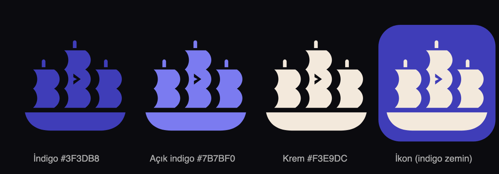
</p>

| Color | Hex | Use |
|---|---|---|
| Indigo | `#3F3DB8` | Mark, app icon background |
| Light indigo | `#7B7BF0` | Default accent in the UI |
| Cream | `#F3E9DC` | Mark on dark, app icon foreground |
